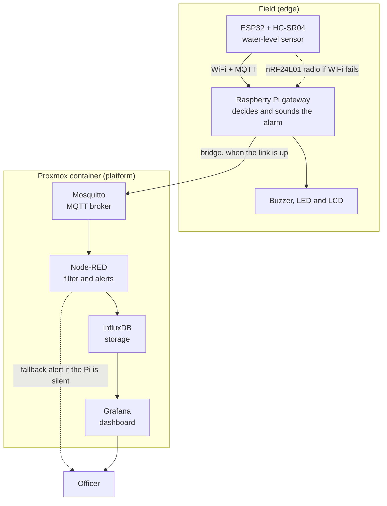
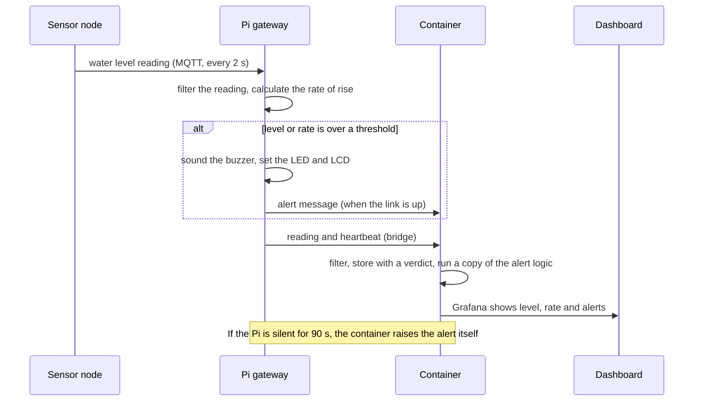
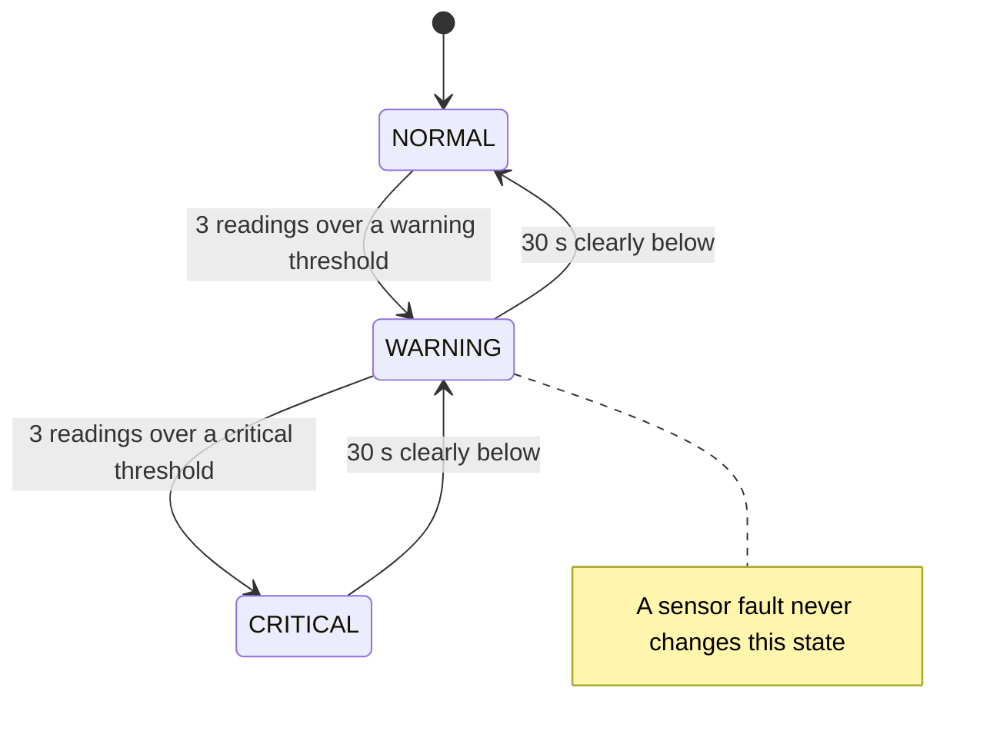

# Flash-Flood Early Warning: an Edge-Cloud IoT Platform

A low-cost water-level monitor for canals in Thai farmland. A sensor node measures the water level. A Raspberry Pi next to the canal decides if a flood is near and sounds an alarm. A server stores the data and shows a dashboard. The alarm still works when WiFi or the server link is down.

This is the capstone project for AST01.41, Fundamentals of Internet of Things and Cloud Computing, at the Asian Institute of Technology.

## How it works

The decision happens at the edge, next to the canal. The server is not on the critical path.



Two failures do not stop the alarm:
- **WiFi fails.** The sensor node switches to a separate radio link to the Pi.
- **The link to the server fails.** The Pi decides and sounds the alarm alone.

## One reading, from sensor to dashboard



## Alert states

Each sensor node has one flood state. A dead sensor never changes it. The platform reports a dead sensor as a separate fault.



A warning threshold exists for the water level and for the rate of rise. A fast rise therefore warns you before the level is high.

## Quick start

You need Node.js 20 or later. You do not need hardware, because a built-in simulator sends realistic data.

```bash
git clone https://github.com/silanm/flash-flood.git
cd flash-flood
npm test                   # 73 tests, no network and no install needed
cp .env.example .env       # enter the details of your Node-RED, InfluxDB and Grafana
node scripts/deploy.mjs    # installs the flows and the dashboard, then starts the simulator
```

`deploy.mjs` needs a running Node-RED 4 or later, InfluxDB 2.x, Grafana and an MQTT broker. [The operating manual](docs/OPERATING.md) lists the steps and the settings.

## Status

| Part | State |
|---|---|
| Server side: filtering, alerts, fallback, dashboard, REST endpoints | Built and tested. It runs on a lab container with simulated data. |
| Pi gateway flows (edge and cloud-only modes) | Built and tested on a fake clock. They never ran on a real Pi. |
| ESP32 firmware, nRF24L01 failover, buzzer, LED and LCD drivers | Not in this repo. The equipment owner builds them. |
| Real sensor data, benchmarks, power measurements | Not done yet. |

## Read next

| I want to | Read |
|---|---|
| Run, configure or troubleshoot the platform | [docs/OPERATING.md](docs/OPERATING.md) |
| Understand the design and the decisions | [ARCHITECTURE.md](ARCHITECTURE.md) |
| Set up the Raspberry Pi | [docs/PI_SETUP.md](docs/PI_SETUP.md) |
| See what we built, what we tested and what remains | [docs/IMPLEMENTATION_LOG.md](docs/IMPLEMENTATION_LOG.md) |
| See the raw test data and dashboard screenshots | [docs/evidence/README.md](docs/evidence/README.md) |

## Repository layout

```
src/        the logic: pipeline, alerts, REST, Pi hub, simulator (pure functions, tested)
test/       73 unit and scenario tests
nodered/    builds the Node-RED flows, including nodered/pi.flows.json for the Pi
grafana/    the dashboard as code
scripts/    deploy script and broker security scripts
mosquitto/  broker topic rules and a Pi bridge template
config/     site.json holds every number that you can tune
docs/       manual, Pi setup, build log, evidence and figures
```
